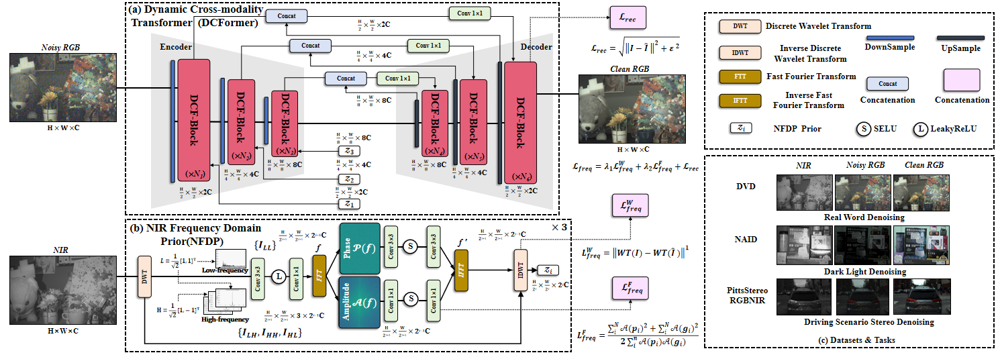

# FreqNIR: Frequency Separated Near-infrared Prior Extraction for Cross-modality Image Denoising

<center>
  
</center>

FreqNIR restores a clean RGB image from an aligned noisy RGB/NIR pair. It first learns a
three-scale NIR Frequency Domain Prior (NFDP), then injects those priors into a Dynamic
Cross-modality Transformer (DCFormer) through Dynamic Cross-modality Attention.

## Highlights

- **Frequency-separated NIR priors.** Haar DWT separates the low-frequency band from the
  three high-frequency bands. FFT amplitude and phase are refined independently before IDWT.
- **Dynamic cross-modality fusion.** DCAttention combines RGB-to-NIR cross-attention, NIR
  self-attention, and a learnable distance-position bias.
- **Local gated refinement.** DCG-FFN performs depth-wise local aggregation and adaptive
  RGB/NIR feature gating.

## Installation

```bash
cd FreqNIR
python -m venv .venv
source .venv/bin/activate
python -m pip install --upgrade pip
pip install -r requirements.txt
pip install -e .
```

## Datasets

The experiments use three public RGB-NIR datasets.

- **DVD:** [Google Drive](https://drive.google.com/drive/folders/10FV0q_GAP4gjQUbQ78waezfyGO07AxlP?usp=share_link)
- **Real-NAID:** [official repository and download instructions](https://github.com/ronjonxu/NAID)
- **PittsStereo-RGBNIR:** [official project page](https://www.cs.cmu.edu/~ILIM/projects/AA/RGBNIRStereo/)

Convert each benchmark into aligned RGB/NIR image triplets. Files are paired by their relative
path and filename stem; extensions may differ. PNG, JPEG, TIFF, BMP, and numeric NPY arrays
are supported. All modalities in a triplet must have identical spatial dimensions.

```text
data/
├── DVD/
│   ├── train/
│   │   ├── noisy_rgb/    # degraded RGB input
│   │   ├── nir/          # aligned NIR guidance
│   │   └── gt/           # clean RGB target
│   └── test/
│       ├── sigma_2/{noisy_rgb,nir,gt}/
│       ├── sigma_4/{noisy_rgb,nir,gt}/
│       ├── sigma_6/{noisy_rgb,nir,gt}/
│       └── sigma_8/{noisy_rgb,nir,gt}/
├── Real-NAID/
│   ├── train/{noisy_rgb,nir,gt}/
│   └── test/
│       ├── level_1/{noisy_rgb,nir,gt}/
│       ├── level_2/{noisy_rgb,nir,gt}/
│       └── level_3/{noisy_rgb,nir,gt}/
└── PittsStereo-RGBNIR/
    ├── train/{noisy_rgb,nir,gt}/
    └── test/
        ├── gaussian_0.2/{noisy_rgb,nir,gt}/
        └── poisson_gaussian_0.02_0.2/{noisy_rgb,nir,gt}/
```

For datasets that provide clean RGB/NIR pairs, synthetic Gaussian or Poisson-Gaussian inputs
can be generated without modifying the originals:

```bash
python tools/make_noisy_pairs.py \
  --clean-rgb path/to/clean_rgb \
  --nir path/to/nir \
  --output data/DVD/test/sigma_4 \
  --gaussian-sigma 4
```

Use `--poisson-alpha 0.02 --gaussian-sigma 0.2` for the Poisson-Gaussian setting.

## Training

Edit dataset paths and hardware settings in [`configs/default.yaml`](configs/default.yaml).

### 1. Pre-train NFDP

```bash
torchrun --standalone --nproc_per_node=2 train.py \
  --config configs/default.yaml \
  --stage nfdp
```

The five-epoch NFDP checkpoint is written to:

```text
experiments/nfdp/checkpoints/best.pt
```

### 2. Train FreqNIR

```bash
torchrun --standalone --nproc_per_node=2 train.py \
  --config configs/default.yaml \
  --stage full \
  --nfdp-checkpoint experiments/nfdp/checkpoints/best.pt
```

Single-GPU training uses the same commands with `python train.py` in place of `torchrun`.
Training can be resumed with `--resume path/to/last.pt`. After training, the checkpoint used for
inference and evaluation is:

```text
experiments/freqnir/checkpoints/best.pt
```

## Inference

Run on either two files or two directories whose relative stems match:

```bash
python infer.py \
  --config configs/default.yaml \
  --checkpoint experiments/freqnir/checkpoints/best.pt \
  --rgb examples/noisy_rgb \
  --nir examples/nir \
  --output results
```

## Evaluation

```bash
python evaluate.py \
  --config configs/default.yaml \
  --checkpoint experiments/freqnir/checkpoints/best.pt \
  --data data/DVD/test/sigma_4 \
  --save-images results/DVD_sigma4
```

## License

Released under the [MIT License](LICENSE).
